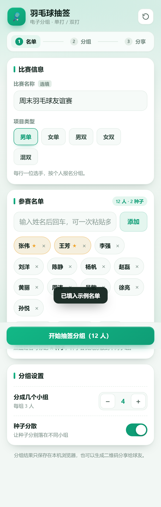
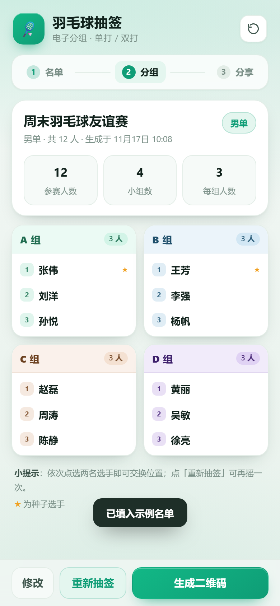
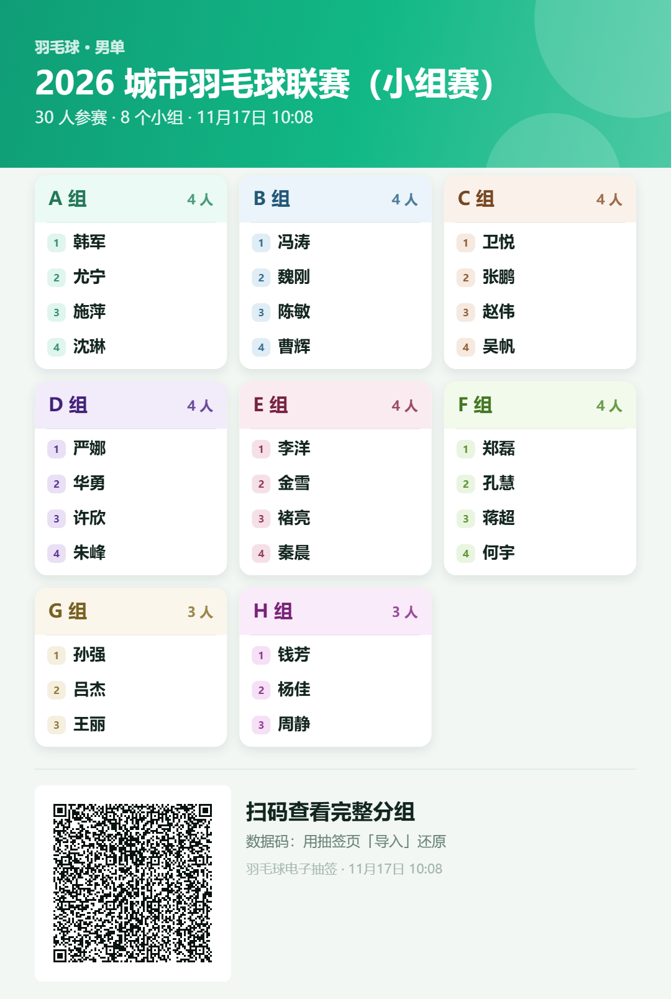

# 羽毛球抽签 · 电子分组

在线使用：**<https://pilotphil.github.io/badminton-chouqian/>**

个人主页入口：**<https://pilotphil.github.io/#other>**（主页「其他」栏目）

一个手机端优先的羽毛球电子抽签网页：录入名单 → 一键随机分组 → 生成二维码 / 分组海报分享给球友。

纯前端静态页面，无需后端、无需构建，双击 `index.html` 就能用。



## 快速开始

直接双击 `index.html` 用浏览器打开即可。

想让手机也能访问（并且让二维码变成可点击的分享链接），用任意静态服务器起一个本地服务：

```bash
# 方式一：Python
python -m http.server 8080

# 方式二：Node
npx serve -l 8080
```

然后浏览器打开 `http://localhost:8080`，手机连同一个 Wi-Fi 用 `http://电脑IP:8080` 访问。

## 功能

| 功能 | 说明 |
| --- | --- |
| 项目类型 | 男单 / 女单 / 男双 / 女双 / 混双，双打按「搭档组合」录入（如 `张三/李四`） |
| 名单录入 | 单个输入、批量粘贴（自动去掉行号/序号/空行）、重复姓名自动跳过 |
| 种子选手 | 点姓名即可标记 ★ 种子，抽签时优先分散到不同小组 |
| 分组数量 | 1~32 组自由调整，自动均衡每组人数（最多相差 1 人） |
| 随机抽签 | 加密级随机数（`crypto.getRandomValues`）+ 蛇形排位，种子均匀分布 |
| 手动微调 | 依次点选两人即可交换位置，点「重新抽签」可再摇一次 |
| 二维码 | 扫码打开/还原本次分组，可保存为 PNG 图片 |
| 分组海报 | 一键生成 1080px 宽的长图（含二维码），适合发微信群 |
| 数据还原 | 扫二维码、贴链接、或粘贴数据码都能完整还原分组 |
| 本地保存 | 名单与结果存在浏览器 localStorage，刷新不丢 |
| 适配 | 手机竖屏优先，兼容 320px 小屏 / 平板 / 桌面，支持深色模式 |

## 界面预览

| 分组结果（手机） | 分组海报（可保存转发） |
| --- | --- |
|  |  |

## 目录结构

```
index.html          页面结构
styles.css          样式（移动端优先 + 深色模式）
app.js              抽签逻辑、二维码、海报绘制
vendor/qrcode.js    QR 码生成库（qrcode-generator，MIT）
tools/              开发自检脚本，可整目录删除，不影响网页运行
```

## 抽签是怎么分的

1. 按设置的小组数算出每组人数，多出来的人依次分给前几组，保证「组间人数最多差 1」。
2. 把小组位置排成蛇形顺序（A B C D → D C B A → …），种子选手按顺序先占各组的第 1 位，因此种子不会扎堆。
3. 其余选手洗牌后按蛇形顺序填满剩余位置。

想完全随机，把「种子分散」开关关掉即可。

## 二维码说明

二维码内容是分组数据的紧凑编码（JSON → UTF-8 → base64url），放在链接的 `#d=` 后面：

- **通过 http(s) 打开**（部署到服务器 / GitHub Pages / 局域网 IP）：二维码就是分享链接，扫一下直接打开并还原分组。
- **通过 `file://` 双击打开**：浏览器不允许跨设备打开本地文件，所以二维码里是数据码本身，可以复制到「导入二维码内容」里还原，或者直接用海报分享。

数据都存在本地，不上传任何服务器。

## 部署

在线站点由 GitHub Pages 的「分支部署」提供：仓库 `main` 分支根目录即网站内容，推送后自动发布。

换到自己的托管也很简单：把 `index.html`、`styles.css`、`app.js`、`vendor/` 上传到任意静态托管即可（GitHub Pages、Vercel、Netlify、Nginx、对象存储…），不需要 Node 环境。`.nojekyll` 用于告诉 GitHub Pages 不要走 Jekyll 处理。

## 开发自检

`tools/check.mjs` 会用无头 Chrome 跑一遍完整流程：截图多种尺寸、解码二维码、校验分组规则、测试双打与链接还原。

```bash
cd tools
npm install            # jsqr + pngjs
cd ..
node tools/check.mjs   # 结果输出到 tools/out
```

## 已知边界

- 双打项目按「一组搭档」录入，一个条目就是一对；自动配对（按性别随机搭档）可后续再加。
- 单个二维码在文件模式下大约可容纳 60~70 个名字，再多建议用海报或分多次抽签。
- 分组只做小组分配，不含小组循环赛程编排。
